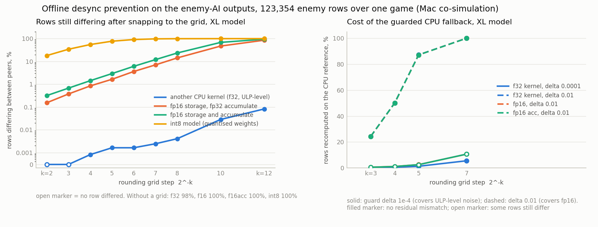

# Study 3, step 9: desync-prevention methods compared offline (Mac, 2026-10-13)

Question: when two peers of a lockstep game run the same enemy-AI model on
different hardware, can rounding, fixed-point outputs or a CPU-reference
fallback keep their simulations identical, and what does each cost? This
note answers it with the real trained models on the Mac, before any device
data exists. The device traces (Poco, tablets) go through the same scripts.

What is modelled, not measured: the Mac's LiteRT CPU kernels are not the
Poco's, fp16 is emulated in numpy, and no NPU or GPU delegate runs here. The
numbers are realistic *magnitudes* of cross-backend differences, and the
prevention arithmetic on top of them is exact.

## Setup

- Models: the APK's own `policy_xlarge` (534,531 parameters) and
  `policy_tiny` (291 parameters), float32 and full-integer int8 files from
  `app/src/main/assets/models` (the int8 output tensor has scale 1/128 and
  zero point 0, so int8 outputs sit on a 2^-7 grid by construction).
- Game: the C++ simulation itself (`tools/hostsim`, built from `game.cpp`),
  world 240 x 534, 60 Hz fixed step, 10 waves of 8 to 80 enemies, fixed RNG
  seed. A `--pipe` mode hands every tick's feature rows to Python and takes
  the outputs back, so the game runs under the real model in any backend.
- Backends (`analysis/policy_backends.py`):
  `lite_f32` LiteRT float32 (XNNPACK), the reference;
  `np_f32` the same weights as a numpy float32 MLP (Accelerate BLAS), a
  different CPU kernel, so ULP-level differences, the proxy for "another
  chip's CPU F32";
  `np_f16` fp16 weights and activations, fp32 accumulation, the best case
  for a GPU or NPU running the f32 model at reduced precision;
  `np_f16acc` as above with fp16 accumulation too (chunked emulation), the
  pessimistic case;
  `lite_int8` the int8 model with the app's quantize / dequantize path;
  `np_f64` float64, the exact reference used to size each backend's error.
- Prevention methods, applied by every peer to the model output before the
  game consumes it (`analysis/cosim.py`, class `Prevent`):
  `grid:K` snap all three outputs to multiples of 2^-K (round half even);
  `fallback:D` hybrid, the fast backend serves every row except those whose
  fire value is within D of the 0.35 threshold, which are recomputed on the
  CPU reference;
  `grid:K+fallback:D` the same guard, but with the grid on the "boundary"
  is any rounding edge of any of the three outputs (the edge nearest 0.35 is
  the effective fire threshold once a grid is on).
  Fixed-point outputs are the `grid:7` case: the int8 model's own output
  grid.
- Traces: one full game per (backend, method) in closed loop, and for the
  open-loop tables one reference game's inputs (XL: 3,724 ticks, 123,354
  enemy rows, mean 33 alive per tick; tiny: 4,407 ticks, 129,744 rows)
  replayed through every backend, exactly like the app's REPLAY INPUT.
- Metrics. Open loop: share of rows whose output vector still differs between
  the two peers after the method, fire decisions that still differ per 1,000
  rows, share of rows the hybrid hands to the CPU, and the RMS change the grid
  itself makes to the reference steer (behaviour cost). Closed loop: are the
  two traces byte-identical; first tick where outputs and where the game
  state differ; share of ticks with a differing state; mean distance between
  the same enemy in both runs; game length and final hp.

Determinism checks that passed on the Mac: the reference run repeated is
byte-identical in closed loop; LiteRT CPU f32 gives identical outputs for the
same rows at batch N and N+16 (zero padding rows) and with 1 or 4 threads.

## 1. Raw cross-backend differences (no prevention)

Open loop, same inputs, against `lite_f32`.

| backend | model | rows differing | max abs diff | mean abs diff | fire flips per 1k rows |
|---|---|---|---|---|---|
| np_f32 (other CPU kernel) | XL | 98.4 % | 1.3e-6 | 8e-8 | 0 |
| np_f64 (exact) | XL | 97.3 % | 1.2e-6 | 7e-8 | 0 |
| np_f16 | XL | 100 % | 4.9e-3 | 1.4e-4 | 0.008 |
| np_f16acc | XL | 100 % | 6.7e-3 | 2.9e-4 | 0.016 |
| lite_int8 | XL | 100 % | 0.88 | 1.7e-2 | 5.6 |
| np_f32 | tiny | 98.1 % | 4.8e-7 | 5e-8 | 0 |
| np_f16 | tiny | 100 % | 2.1e-3 | 2.2e-4 | 0.077 |
| np_f16acc | tiny | 100 % | 2.3e-3 | 2.3e-4 | 0.092 |
| lite_int8 | tiny | 100 % | 0.58 | 6.9e-2 | 9.4 |

Three regimes, three orders of magnitude apart: ULP-level (two float32
kernels, about 1e-7 mean), fp16-level (about 2e-4 mean, 5e-3 max) and
model-level (the int8 model is a different function, up to 0.9 off, with a
fire decision flipped every ~180 rows). Fire flips are rare for fp16 because
the trained fire output is bimodal (59 % of rows below -0.9, 19 % above 0.9;
only 0.03 % of XL rows lie within 0.01 of the threshold).

## 2. Output rounding grid



Rows still differing after both peers snap to 2^-K (XL; tiny in
`prevention_grid_tiny.png` and `runs_study3/mac/openloop_tiny/openloop.csv`):

| K (step) | np_f32 | np_f16 | np_f16acc | lite_int8 | steer RMS change |
|---|---|---|---|---|---|
| 2 (0.25) | 0 | 0.15 % | 0.32 % | 18 % | 0.062 |
| 3 (0.125) | 0 | 0.37 % | 0.67 % | 34 % | 0.033 |
| 4 (0.0625) | 0.001 % | 0.84 % | 1.4 % | 55 % | 0.017 |
| 5 (0.031) | 0.002 % | 1.6 % | 2.9 % | 77 % | 0.009 |
| 7 (0.0078) | 0.002 % | 7.1 % | 12 % | 98 % | 0.002 |
| 10 (0.001) | 0.028 % | 47 % | 68 % | 100 % | 0.0003 |

The behaviour follows a one-line model: a value lands within the peers'
difference of a rounding edge with probability about 2 E|d| / step, so the
residual mismatch grows in proportion to 2^K and to the backend's noise.
Consequences:

- Against ULP-level noise a coarse grid works in practice (zero of 123k rows
  at K = 2 or 3, one row at K = 4) but not in principle: at 60 Hz with 30 to
  80 rows per tick, K = 4 still yields about one mismatching row per game and
  tens per hour. The closed-loop tiny runs show it: K = 3 to 5 stayed
  byte-identical for a whole game, K = 7 split at tick 1556 and K = 10 at
  tick 148.
- Against fp16-level noise no grid is usable. Even the coarsest step
  (0.25, which changes the steer by 0.06 RMS on a [-1, 1] scale) leaves 0.15
  to 0.3 % of rows different, several per second of play; closed loop, every
  fp16 run with a grid alone split within the first 60 ticks (tiny: 12).
- Against the int8 model nothing short of the same model on both peers
  helps, as expected.
- Fixed-point outputs (K = 7, the int8 output grid) are just a fine grid for
  a float peer: 0.002 % (ULP) to 7 to 12 % (fp16) of rows still differ. The
  interesting fixed-point case is two peers both running the int8 model,
  where the outputs are integers by construction and sync depends only on
  the integer kernels agreeing. That is a device question (CPU int8 against
  NPU int8 on the Poco, CPU int8 across chips), not answerable on the Mac.

## 3. Guarded CPU-reference fallback

Guarding the fire threshold alone (`fallback:D`) is cheap (0.01 % of rows at
D = 0.005) and removes the fire flips, but it leaves the steer noise in
place, and the closed-loop runs show that steer noise alone changes kill and
ramming timing: every fp16 fallback-only run diverged from tick 0 and ended
with a different length and hp. So the guard has to cover the rounding
edges of the steer too, which ties it to a grid.

With the guard radius D above the backend's maximum difference, the two
peers' outputs are identical by construction (every "zero residual" cell
below was byte-identical in closed loop for the tiny model as well). What it
costs is the share of rows that must be recomputed on the CPU reference:

| method | np_f32 rows to CPU | residual | np_f16 rows to CPU | residual | np_f16acc rows to CPU | residual |
|---|---|---|---|---|---|---|
| grid:3 + fallback:1e-4 | 0.27 % | 0 | 0.57 % | 0.10 % | 0.55 % | 0.42 % |
| grid:4 + fallback:1e-4 | 0.58 % | 0 | 1.2 % | 0.22 % | 1.1 % | 0.85 % |
| grid:5 + fallback:1e-4 | 1.3 % | 0 | 2.6 % | 0.42 % | 2.5 % | 1.7 % |
| grid:7 + fallback:1e-4 | 5.5 % | 0 | 11 % | 1.6 % | 11 % | 6.3 % |
| grid:3 + fallback:0.01 | 24 % | 0 | 24 % | 0 | 24 % | 0 |
| grid:4 + fallback:0.01 | 50 % | 0 | 50 % | 0 | 50 % | 0 |
| grid:5 + fallback:0.01 | 87 % | 0 | 87 % | 0 | 87 % | 0 |
| grid:7 + fallback:0.01 | 100 % | 0 | 100 % | 0 | 100 % | 0 |

(XL, open loop. The cost depends only on the grid, the guard radius and the
output distribution, not on the backend; the residual depends on whether D
exceeds the backend's noise.)

- Two float32 CPUs: a coarse grid plus a 1e-4 guard gives a guarantee for
  0.3 to 0.6 % of rows on the reference path. On the Poco's measured XL
  latencies (CPU f32 7.0 ms at N = 80 against NPU 0.95 ms) that is a few
  tens of microseconds per tick if the flagged rows are batched to the CPU,
  or one extra CPU inference on 1 to 3 % of ticks if whole ticks are redone.
- fp16-class accelerators: the guard must be about 0.01 wide, and then a
  quarter (K = 3) to half (K = 4) of all rows go back to the CPU anyway.
  Since the CPU run has to happen on those rows and the grid at K = 3 already
  costs 0.03 RMS of steer, the accelerator buys little; running the reference
  on everything (the 100 % row) is simpler. At K = 7 (fixed-point outputs)
  the guard covers every row.
- int8 model against a float peer: no combination short of 100 % works
  (1.9 to 6 flips per 1,000 rows remain at every partial setting).

## 4. Closed loop: does an output difference become a desync?

Tiny model, one game per cell, `runs_study3/mac/matrix_tiny/pairs.csv`
(XL in `matrix_xl/pairs.csv`, see section 5):

| backend vs lite_f32 | method | identical | first state diff (tick) | ticks differing | mean drift (px) | length a/b | hp a/b |
|---|---|---|---|---|---|---|---|
| lite_f32 repeat | none | yes | | 0 | 0 | 4407/4407 | 5/5 |
| np_f32 | none | no | 6 | 98.7 % | 0.000 | 4407/4407 | 5/5 |
| np_f32 | grid:3, 4, 5 | yes | | 0 | 0 | same | same |
| np_f32 | grid:7 | no | 1556 | 24.8 % | 0.000 | 4406/4406 | 5/5 |
| np_f32 | grid:10 | no | 148 | 71.3 % | 0.000 | 4407/4407 | 5/5 |
| np_f32 | grid:3..5 + fallback:1e-4 | yes (0.5 to 1.9 % rows to CPU) | | 0 | 0 | same | same |
| np_f16 | none | no | 0 | 100 % | 12.7 | 4407/4356 | 5/6 |
| np_f16 | grid:3 / 4 / 5 | no | 12 / 1 / 4 | 99 to 100 % | 27 / 56 / 42 | differ | differ |
| np_f16 | fallback:0.005 (fire only) | no | 0 | 100 % | 12.7 | 4407/4356 | 5/6 |
| np_f16 | grid:3 + fallback:1e-4 | no | 165 | 92.6 % | 27 | 4441/4439 | 5/6 |
| np_f16 | grid:3 / 4 / 5 + fallback:0.01 | yes (43 / 71 / 96 % rows to CPU) | | 0 | 0 | same | same |
| np_f16acc | as np_f16 | as np_f16 | | | | | |
| lite_int8 | anything but 100 % CPU | no | 0 | 100 % | 42 to 142 | differ | differ |

Two things the open-loop tables cannot show:

- ULP-level steer noise without prevention desyncs the *fingerprint*
  immediately (state differs from tick 6 on) but not the *game*: positions
  differ by less than a thousandth of a pixel, the run has the same length,
  score and hp. A lockstep hash check would still disconnect the players.
- fp16-level noise can change the game: for the tiny model the enemies
  drift by 13 px on average, the run length differs by 50 ticks and the hp by
  one, and there is no reconvergence at wave boundaries once kill timing has
  changed (unlike the scripted single-perturbation test of session 7). For
  the XL model the same noise stayed invisible in this game (section 5).
- Game outcome is robust in a coarse sense: every one of the 134 runs across
  both models ends in victory with all 440 enemies killed and hp 5 to 7.
  Desync is a problem of identity, not of playability.

## 5. XL closed loop

XL model, one game per cell, 67 runs, all victory with 440 kills, hp 6 or 7,
length 3,683 to 3,739 ticks (`runs_study3/mac/matrix_xl/pairs.csv`):

| backend vs lite_f32 | method | identical | first state diff (tick) | ticks differing | mean drift (px) | length a/b | hp a/b |
|---|---|---|---|---|---|---|---|
| lite_f32 repeat | none | yes | | 0 | 0 | 3724/3724 | 6/6 |
| np_f32 | none | no | 12 | 98.8 % | 0.000 | 3724/3724 | 6/6 |
| np_f32 | grid:3 | yes | | 0 | 0 | 3697/3697 | 6/6 |
| np_f32 | grid:4 / 5 | no | 3364 / 3457 | 9.6 / 6.8 % | 0.000 | same | same |
| np_f32 | grid:7 | no, reconverged by the end | 1035 | 19.1 % | 0.000 | 3724/3724 | 6/6 |
| np_f32 | grid:10 | no | 87 | 48.9 % | 0.000 | 3724/3724 | 6/6 |
| np_f32 | grid:3 / 4 / 5 + fallback:1e-4 | yes (0.26 / 0.63 / 1.33 % rows to CPU) | | 0 | 0 | same | same |
| np_f16 | none | no | 0 | 100 % | 0.006 | 3724/3724 | 6/6 |
| np_f16 | grid:3 / 4 / 5 / 7 | no | 18 / 56 / 1 / 6 | 98 to 100 % | 48 / 0.02 / 72 / 0.01 | 3697/3693, same, 3711/3713, same | 6/6, 6/6, 7/6, 6/6 |
| np_f16 | grid:3 / 4 / 5 + fallback:1e-4 | no | 161 / 56 / 10 | 89 to 98 % | 0.01 | same | same |
| np_f16 | grid:3 / 4 / 5 / 7 + fallback:0.01 | yes (24 / 50 / 87 / 100 % rows to CPU) | | 0 | 0 | same | same |
| np_f16acc | as np_f16 | as np_f16 (splits at 95 / 14 / 1 / 5 with a grid alone) | | | | | |
| lite_int8 | anything but 100 % CPU | no | 0 (5 at grid:5 + 0.01) | 100 % | 72 to 124 | differ | differ |

The XL picture matches the tiny one, with two refinements. First, the
ULP-level pair holds a whole game only at K = 3 (K = 4 and 5 split after
3,300 ticks, one row in 123k as the open-loop rate predicts), so the grid
alone is a lottery over the session length and the guard is what makes it
a guarantee. Second, whether a split is visible is a per-game coin toss:
the fp16 XL run without prevention stayed within 0.006 px of the reference
with the same length and hp (30 % of XL outputs are saturated at +-1 and
identical in every backend), while the tiny fp16 run drifted 13 px and
ended with a different length and hp. The fingerprint split at tick 0 in
both; a lockstep game checks the fingerprint, not the picture.

## 6. What to look for in the device data

The Poco replays (five configs over the same `replay_input.bin`) place each
backend pair into one of the three regimes by its raw mean and max |diff|
against CPU F32; the Mac tables then say what prevention can do:

1. CPU F32 vs NPU F32 or GPU F32 within about 1e-6: ULP regime. A grid at
   K = 3 or 4 plus a 1e-4 guard keeps lockstep at < 1 % CPU rows. If the
   device pair is *bit-exact* (possible if the APU keeps fp32), no
   prevention is needed at all for that pair.
2. Mean |diff| around 1e-4 and max around 5e-3: fp16 regime (`allow_fp16`
   is set for NNAPI; the GPU delegate defaults to fp16). The accelerator
   output cannot be made authoritative at reasonable cost; use it for
   non-authoritative work or run the reference on the CPU.
3. CPU INT8 vs NPU INT8 (both the int8 model): if bit-exact, fixed-point
   outputs by construction are the cheapest prevention of all (no grid, no
   guard, 1 ms per tick on the NPU). If they differ, the differences are
   whole output steps (1/128) and no grid can hide them.
4. Across chips (Poco vs Tab S6 Lite vs A56): CPU F32 against CPU F32 is
   expected in the ULP regime (different cores, same XNNPACK); CPU INT8
   against CPU INT8 is the fixed-point test across vendors.

Commands for the device data, once pulled to `runs_study3/<device>/files/`:

```
python3 analysis/determinism.py matrix --ref REF_trace.bin out.csv replay_*.bin
python3 analysis/prevention.py table --ref REF_trace.bin out_prev.csv replay_*.bin
python3 analysis/determinism.py free A_trace.bin B_trace.bin
```

## 7. Limitations

- Mac proxies: the ULP regime is modelled by two different CPU kernels on one
  chip, the fp16 regime by numpy emulation (storage, and storage plus
  accumulation); real delegates may add fused-multiply-add and
  transcendental (tanh) differences of their own. The int8 path uses
  LiteRT's reference integer kernels on the Mac.
- One game per cell; the closed-loop split ticks are single samples. The
  open-loop rates over 123k to 130k rows are the robust numbers.
- The grid's behaviour cost is reported as the open-loop RMS steer change;
  closed-loop drift between a gridded and an ungridded run is not a fidelity
  measure because the game is chaotic (27 to 52 px for the tiny model at
  K = 3 to 5 with identical outcomes).
- The guard assumes the per-row CPU reference is available on demand. On a
  phone that means a second interpreter resident on the CPU; its cost was
  not measured here (a previous research project measured the full-batch CPU latencies).

## Reproduction

```
tools/hostsim/build.sh
python3 analysis/cosim.py matrix runs_study3/mac/matrix_xl            # ~30 min
python3 analysis/cosim.py matrix runs_study3/mac/matrix_tiny --variant tiny
python3 analysis/cosim.py compare runs_study3/mac/matrix_xl
python3 analysis/policy_backends.py replay REF_trace.bin BACKEND out.bin
python3 analysis/prevention.py table --ref REF_trace.bin openloop.csv replay_*.bin --label-from-name
python3 analysis/study3_charts.py openloop_xl.csv openloop_tiny.csv analysis/out_study3/prevention_grid.png
```

Python: system python3 3.9 with numpy and tensorflow 2.20 (user site) for
the LiteRT interpreter; the `ai-edge-litert` macOS wheels are broken
(missing dylib) as of 2.0.3.
